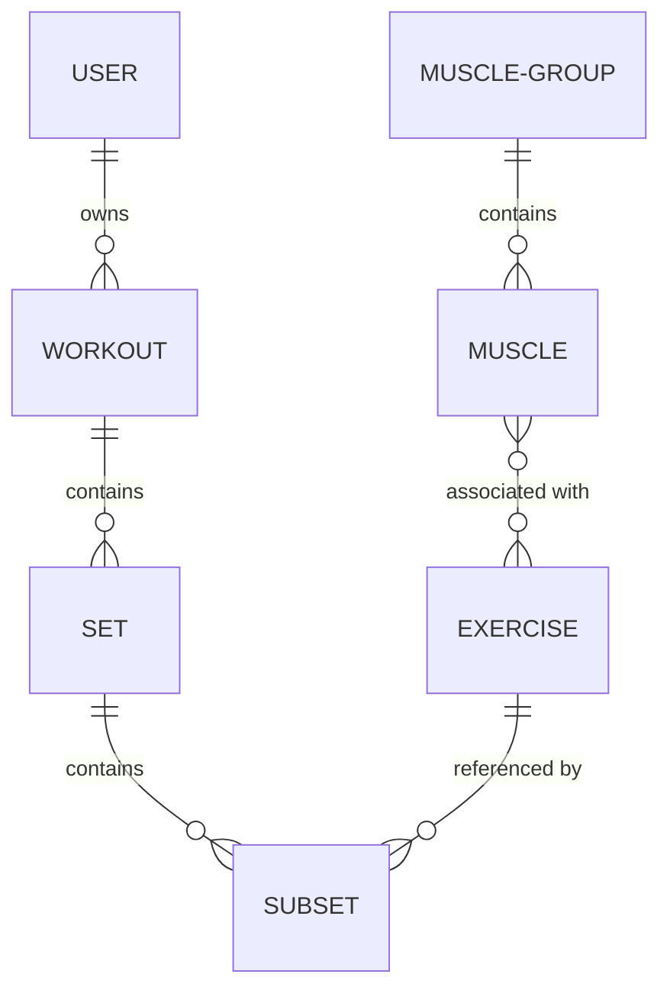

# Domain Model

## Overview

This document defines the core domain concepts, relationships and business rules of Max Pondus.

It serves as a reference for frontend and backend development, architectural decisions and AI-assisted code generation.

The domain model is technology-independent. It describes business concepts rather than database tables, API payloads or implementation-specific structures.

## Entity Relationship Diagram

## Entities

| Entity       | Description                                                                            |
| ------------ | -------------------------------------------------------------------------------------- |
| Exercise     | A defined physical movement performed during training (e.g. Dumbbell Row).             |
| Muscle       | A specific muscle involved in performing exercises.                                    |
| Muscle Group | A category of related muscles (e.g. Chest).                                            |
| Set          | A logical training unit that can represent a normal set, superset, or drop set.        |
| Subset       | A planned or performed set of repetitions of a single exercise.                        |
| User         | An identifiable user of the application.                                               |
| Workout      | An individual training session.                                                        |

## Business Rules

### Workout

- Workouts can be saved without being completed.
- Recorded Workouts can be modified afterwards.
- Sets within a Workout have a defined order.

### Set

- Subsets within a Set have a defined order.
- Subsets within the same Set may reference the same or different Exercises.
- Subsets within the same Set may have different weights and repetition counts.

### Subset

- A Subset may represent a planned or performed exercise set.
- Planned Subsets do not require actual performance data.
- Weight and repetition count cannot be negative.
- Exercises may be performed without additional weight.
