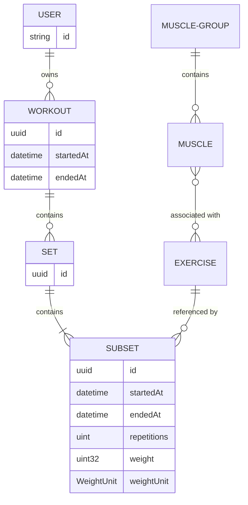

# Domain Model

## Overview

This document defines the core domain concepts, relationships and business rules of Max Pondus.

It serves as a reference for frontend and backend development, architectural decisions and AI-assisted code generation.

The domain model is technology-independent. It describes business concepts rather than database tables, API payloads or implementation-specific structures.

## Entity Relationship Diagram

## Entities

| Entity       | Description                                                                          |
| ------------ | ------------------------------------------------------------------------------------ |
| Exercise     | A defined physical movement performed during training (e.g. Dumbbell Row).           |
| Muscle       | A specific muscle involved in performing exercises.                                  |
| Muscle Group | A category of related muscles (e.g. Chest).                                          |
| Set          | A logical grouping of exercise repetition sets performed as a single training round. |
| Subset       | A recorded performance or attempt of a single exercise.                              |
| User         | An identifiable user of the application.                                             |
| Workout      | An individual training session.                                                      |

## Reference Data

Exercises, Muscles and Muscle Groups are predefined domain concepts identified by stable, language-independent codes.

Their allowed values and relationships are defined in [shared/exercises.json](../shared/exercises.json).

The catalog serves as the single source of truth for these definitions.

Display names and descriptions are localized by the frontend.

## Business Rules

### Workout

- A Workout must have a start time, but its end time is optional.
- When provided, endedAt must not precede startedAt.
- Workouts can be saved without being completed.
- Recorded Workouts can be modified afterwards.
- Sets within a Workout are ordered by the earliest available Subset start time, when available.

### Set

- A Set represents a single training round containing explicitly grouped Subsets.
- A multi-round superset consists of multiple Sets, each containing the Subsets performed during that round.
- Each Set independently defines its Subsets, regardless of the composition of other Sets in the Workout.
- Subsets within a Set are ordered by their start times, when available. Timestamps do not determine Set membership.
- Subsets within the same Set may reference the same or different Exercises.
- Subsets within the same Set may have different weights and repetition counts.

### Subset

- Weight and repetition count cannot be negative.
- Exercises may be performed without additional weight.
- Subset timestamps are optional. When both are provided, endedAt must not precede startedAt.
- A continuous isometric hold counts as one repetition.
- A Subset's duration is calculated as the difference between endedAt and startedAt when both timestamps are available.

### Identifier Stability

- Published identifiers must not be changed or reused, as they may be referenced by recorded Workouts.
- Identifiers referenced by recorded Workouts must remain resolvable.

### Weight

- Weight represents the external load used during an exercise, excluding the user's body weight.
- Weight is stored as an unsigned integer representing one-thousandth of the specified WeightUnit.
- Supported weight units are KG (kilograms) and LB (pounds).
